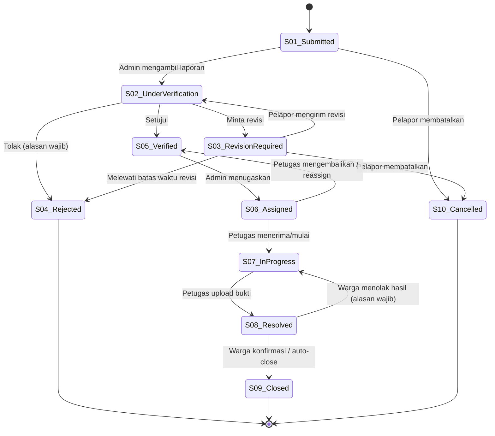
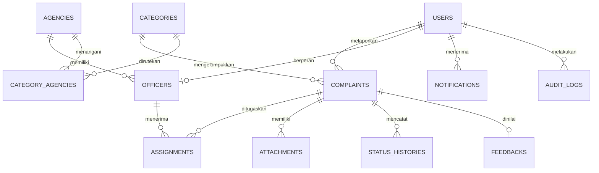
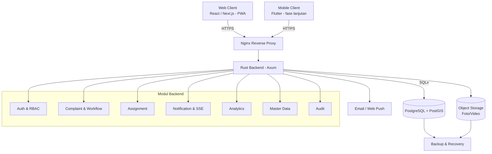

# PRODUCT REQUIREMENTS DOCUMENT (PRD)

# SMART PUBLIC COMPLAINT SYSTEM (SPCS)

**Sistem Pengaduan Masyarakat Cerdas Berbasis Web (Mobile-Responsive / PWA)**

| Metadata | Keterangan |
|---|---|
| Judul Proyek | Smart Public Complaint System (SPCS) |
| Nama Produk | Sistem Pengaduan Masyarakat Cerdas |
| Versi PRD | **1.1** (revisi dari v1.0) |
| Status Dokumen | Draft – Menunggu review & persetujuan |
| Penulis | Rafi Naufal Arsi |
| Pembimbing / Penanggung Jawab Akademik | Dr. Erliyan Redy Susanto, M.Kom |
| Kategori Proyek | Smart City – Public Service |
| Platform MVP | Web Application, responsif (desktop, tablet, smartphone), dengan opsi PWA |
| Target Pengguna | Warga, Petugas Lapangan, Admin Dinas, Super Admin Pemda |
| Backend | Rust (Axum, Tokio, SQLx) |
| Database | PostgreSQL + PostGIS |
| Frontend | React / Next.js |
| Target Timeline | 10 minggu (rekomendasi); 8 minggu hanya jika cakupan dibatasi pada *Must Have* (lihat Bagian 14) |
| Target Implementasi | Prototype/MVP untuk lingkungan Pemerintah Daerah |

### Riwayat Revisi

| Versi | Tanggal | Perubahan |
|---|---|---|
| 1.0 | – | Draf awal |
| 1.1 | 10 Nov 2026 | Penambahan state machine status, role Super Admin, kebijakan privasi & UU PDP, spesifikasi keamanan upload, model data lengkap, risiko, strategi pengujian, acceptance criteria terukur, traceability matrix, timeline realistis. Rincian lengkap pada **Lampiran A**. |

### Daftar Isi

1. Latar Belakang & Pernyataan Masalah
2. Tujuan Produk & KPI
3. Stakeholder, Persona & Hak Akses
4. Alur Utama Pengguna (End-to-End)
5. Kebutuhan Fungsional
6. Alur Status Pengaduan (State Machine)
7. Aturan Bisnis
8. Kebutuhan Non-Fungsional
9. Arsitektur & Spesifikasi Teknis
10. Aturan Antarmuka (UI/UX & Branding)
11. Ruang Lingkup & Batasan
12. Asumsi, Ketergantungan & Risiko
13. Strategi Pengujian & Acceptance Criteria
14. Timeline & Milestone
15. Keputusan Terbuka (Open Questions)
16. Kesimpulan & Rekomendasi
- Lampiran A: Hasil Evaluasi PRD v1.0 & Daftar Perubahan
- Lampiran B: Traceability Matrix
- Lampiran C: Glosarium

---

## 1. Latar Belakang & Pernyataan Masalah

### 1.1 Latar Belakang

Transformasi digital pemerintah daerah menuntut pelayanan publik yang lebih cepat, transparan, dan terukur. Dalam praktiknya, pengaduan masyarakat masih menghadapi kendala: laporan disampaikan manual atau tersebar di banyak saluran, transparansi penanganan terbatas, dan warga sulit mengetahui perkembangan laporannya.

Di sisi lain, pemerintah daerah membutuhkan sistem yang mengelola laporan secara terpusat, mendistribusikannya kepada instansi berwenang, memonitor kinerja petugas, dan menyediakan statistik untuk pengambilan keputusan.

**Smart Public Complaint System (SPCS)** adalah sistem pengaduan berbasis web yang mengintegrasikan pelaporan, verifikasi, penugasan, penanganan, dan evaluasi dalam satu platform. Backend menggunakan Rust dan PostgreSQL agar data terstruktur, aman, dan dapat dikembangkan.

### 1.2 Problem Statement

Pengelolaan pengaduan masyarakat belum optimal sehingga terjadi keterlambatan penanganan, kurangnya transparansi, dan sulitnya pemantauan kinerja instansi.

| No | Permasalahan | Dampak ke Masyarakat | Dampak ke Pemda |
|---|---|---|---|
| 1 | Proses pengaduan belum terintegrasi | Warga bingung menentukan saluran pelaporan | Data pengaduan tersebar |
| 2 | Tracking laporan tidak memadai | Warga tidak tahu perkembangan laporan | Petugas sulit memberi informasi progres |
| 3 | Distribusi laporan kurang efisien | Penanganan berpotensi terlambat | Beban koordinasi antarinstansi tinggi |
| 4 | Tidak ada pemetaan lokasi | Lokasi sulit dijelaskan akurat | Prioritas wilayah sulit ditentukan |
| 5 | Data belum dianalisis | Masalah berulang sulit dipantau | Evaluasi pelayanan tidak berbasis data |
| 6 | Dokumentasi penanganan tidak terpusat | Hasil tindak lanjut tidak diketahui | Riwayat penyelesaian sulit diaudit |

### 1.3 Solusi yang Ditawarkan

- Pelaporan online dengan foto dan lokasi geografis.
- Verifikasi dan klasifikasi laporan oleh admin.
- Routing tiket ke dinas terkait berdasarkan kategori.
- Penugasan petugas lapangan.
- Pemantauan status mendekati real-time.
- Dashboard analitik untuk Pemda.
- Dokumentasi bukti penyelesaian dan evaluasi (feedback) warga.

### 1.4 Product Vision

> "Menjadi platform pengaduan masyarakat yang terintegrasi, transparan, responsif, dan berbasis data untuk mendukung tata kelola pemerintahan daerah yang cerdas dan berorientasi pada pelayanan masyarakat."

---

## 2. Tujuan Produk & KPI

### 2.1 Tujuan Produk

1. Menyediakan media pelaporan digital yang mudah diakses masyarakat.
2. Meningkatkan efisiensi pengelolaan pengaduan oleh Pemda.
3. Mempercepat distribusi laporan ke instansi yang tepat.
4. Meningkatkan transparansi penanganan.
5. Menyediakan data analitik untuk evaluasi pelayanan publik.
6. Mendukung pengambilan keputusan berbasis data.

### 2.2 Key Performance Indicators (KPI)

| No | KPI | Definisi & Cara Ukur | Target Awal MVP |
|---|---|---|---|
| 1 | Keberhasilan pengiriman laporan | % pengiriman valid yang tersimpan (log API: 2xx / total request valid) | ≥ 98% |
| 2 | Waktu pengiriman laporan | Waktu respons API *submit* (tanpa upload file besar) | ≤ 5 detik |
| 3 | Waktu verifikasi | Durasi S01 → keputusan (S04/S05/S03) | Median ≤ 1 hari kerja |
| 4 | Keberhasilan distribusi tiket | % laporan S05 yang berstatus S06 dalam ≤ 1 hari kerja | ≥ 95% |
| 5 | Transparansi tracking | % perubahan status yang tercatat di `status_histories` **dan** terlihat oleh pelapor | 100% |
| 6 | Ketersediaan sistem | Uptime bulanan (diukur dengan monitoring eksternal) | ≥ 99,5% *(target pilot; lihat catatan)* |
| 7 | Kepuasan pengguna | Rata-rata rating feedback setelah S08/S09 | ≥ 4 dari 5 |
| 8 | Kelengkapan audit | % aktivitas penting yang tercatat di `audit_logs` | 100% |
| 9 | **Waktu penyelesaian (SLA)** *(baru)* | Waktu S06 → S08 per kategori, dibandingkan SLA kategori | Ditetapkan per kategori bersama Pemda |
| 10 | **Tingkat laporan ditolak/direvisi** *(baru)* | % laporan S04 dan S03 dari total laporan | Dipantau (indikator kualitas formulir) |

**Catatan:**
- Seluruh target adalah sasaran awal yang divalidasi lewat uji coba dan disepakati bersama Pemda.
- Uptime 99,5% setara toleransi downtime ±3,6 jam/bulan. Pada MVP dengan satu server tanpa high availability, angka ini diperlakukan sebagai target pilot, bukan jaminan kontrak (SLA formal).
- SLA penyelesaian berbeda per kategori (contoh konfigurasi: lampu jalan rusak 3 hari, jalan berlubang 7 hari, sampah liar 2 hari) dan disimpan sebagai data konfigurasi, bukan hard-code.

### 2.3 Dampak yang Diharapkan

| Pihak | Dampak |
|---|---|
| Masyarakat | Lebih mudah melapor dan mengetahui tindak lanjut |
| Petugas Lapangan | Menerima informasi lokasi, bukti, dan tugas terstruktur |
| Admin Dinas | Lebih mudah mengelola, mendistribusikan, dan memonitor |
| Pemda | Data terpusat untuk evaluasi dan kebijakan |

---

## 3. Stakeholder, Persona & Hak Akses

### 3.1 Stakeholder

| Stakeholder | Peran dalam Proyek |
|---|---|
| Pemerintah Daerah (mitra) | Penyedia struktur instansi, kategori, akun petugas, logo; penerima manfaat utama |
| Universitas Teknokrat Indonesia | Institusi akademik pelaksana proyek |
| Dr. Erliyan Redy Susanto, M.Kom | Pembimbing / penanggung jawab akademik |
| Rafi Naufal Arsi | Pengembang / penulis PRD |
| Warga | Pengguna akhir pelapor |

### 3.2 Persona

#### A. Warga (Citizen / Reporter)
| Atribut | Deskripsi |
|---|---|
| Tujuan | Melaporkan masalah lingkungan dan fasilitas publik |
| Kebutuhan | Proses pelaporan sederhana, cepat, transparan |
| Kendala | Tidak tahu instansi bertanggung jawab; tidak tahu perkembangan laporan; sinyal/GPS tidak selalu baik |
| Fitur utama | Registrasi, login, pengaduan, foto, GPS, tracking, notifikasi, feedback |

#### B. Petugas Lapangan (Field Officer)
| Atribut | Deskripsi |
|---|---|
| Tujuan | Menyelesaikan pengaduan sesuai tugas dan kewenangan |
| Kebutuhan | Informasi laporan, lokasi, bukti, prioritas; antarmuka mobile-friendly |
| Kendala | Informasi tugas tidak terpusat; dokumentasi sulit dikelola |
| Fitur utama | Dashboard tugas, detail tiket, navigasi lokasi, update status, upload bukti penyelesaian |

#### C. Admin Dinas (Agency Admin)
| Atribut | Deskripsi |
|---|---|
| Tujuan | Memverifikasi dan mengelola pengaduan di instansinya |
| Kebutuhan | Dashboard, verifikasi, penugasan, statistik instansi |
| Kendala | Sulit memantau beban kerja petugas dan kinerja penyelesaian |
| Fitur utama | Verifikasi, penugasan, monitoring, statistik instansi |

#### D. Super Admin Pemda *(baru)*
| Atribut | Deskripsi |
|---|---|
| Tujuan | Mengelola konfigurasi sistem dan memantau lintas instansi |
| Kebutuhan | Manajemen pengguna, instansi, kategori, SLA; analitik lintas dinas; audit |
| Fitur utama | Master data, manajemen akun, dashboard lintas instansi, audit log, ekspor data |

> **Alasan penambahan:** PRD v1.0 menggabungkan "Admin Dinas/Pemda" dalam satu role, padahal kebutuhan verifikasi per instansi berbeda dengan pengelolaan sistem dan data lintas instansi. Pemisahan ini juga memenuhi prinsip *least privilege* (NFR-SEC-03).

### 3.3 Matriks Hak Akses (RBAC)

| Modul / Fitur | Warga | Petugas | Admin Dinas | Super Admin |
|---|:-:|:-:|:-:|:-:|
| Registrasi akun | ✓ | — | — | — |
| Login | ✓ | ✓ | ✓ | ✓ |
| Membuat pengaduan | ✓ | — | — | — |
| Melihat pengaduan pribadi | ✓ | — | — | — |
| Membatalkan pengaduan sendiri (S01–S03) | ✓ | — | — | — |
| Melihat tugas pengaduan | — | ✓ (miliknya) | ✓ (instansinya) | ✓ (semua) |
| Verifikasi pengaduan | — | — | ✓ | ✓ |
| Penugasan / reassign petugas | — | — | ✓ | ✓ |
| Menerima / mengembalikan tugas | — | ✓ | — | — |
| Update progres penanganan | — | ✓ | ✓ | ✓ |
| Upload bukti penanganan | — | ✓ | ✓ | ✓ |
| Tracking pengaduan | ✓ (miliknya) | ✓ | ✓ | ✓ |
| Memberi feedback / konfirmasi selesai | ✓ | — | — | — |
| Manajemen kategori & SLA | — | — | — | ✓ |
| Manajemen instansi | — | — | — | ✓ |
| Manajemen pengguna (aktif/nonaktif) | — | — | ✓ (petugas instansinya) | ✓ (semua) |
| Dashboard analitik | — | — | ✓ (instansinya) | ✓ (lintas instansi) |
| Ekspor data | — | — | ✓ (instansinya) | ✓ |
| Audit log | — | — | ✓ (terbatas) | ✓ |

**Prinsip akses:** Admin Dinas dibatasi pada instansi/wilayah kewenangannya. Petugas hanya mengakses tiket yang ditugaskan kepadanya. Warga hanya mengakses laporan miliknya. Pembatasan ditegakkan di backend pada setiap endpoint, bukan hanya di UI.

---

## 4. Alur Utama Pengguna (End-to-End)

1. **Warga** registrasi/login → mengisi formulir (judul, kategori, deskripsi, lokasi, foto, urgensi) → sistem memvalidasi dan menghasilkan **nomor tiket** (S01 Submitted).
2. **Admin Dinas** meninjau laporan (S02) → **menyetujui** (S05), **meminta revisi** (S03), atau **menolak** dengan alasan (S04).
3. Untuk laporan terverifikasi, Admin menetapkan **instansi** dan **petugas** (S06 Assigned).
4. **Petugas** menerima tugas, menuju lokasi, memperbarui progres (S07 In Progress), dan mengunggah **bukti penyelesaian** (S08 Resolved).
5. **Warga** menerima notifikasi, mengkonfirmasi hasil, dan memberi **rating/feedback**; laporan ditutup (S09 Closed) lewat konfirmasi atau penutupan otomatis setelah batas waktu.
6. Setiap perubahan status tercatat pada **status history** dan **audit log**, serta terlihat pada **timeline tracking** warga.

---

## 5. Kebutuhan Fungsional

**Prioritas (MoSCoW):** Must Have (M), Should Have (S), Could Have (C). ID lama dipertahankan; ID baru diawali **(baru)** dan diberi nomor lanjutan.

### 5.1 Registrasi & Autentikasi

| ID | Requirement | Deskripsi | Prioritas |
|---|---|---|---|
| FR-001 | User Registration | Pendaftaran akun warga (nama, email, nomor telepon, password) | M |
| FR-002 | User Login | Login dengan email/nomor telepon dan password | M |
| FR-003 | Password Security | Password di-hash (Argon2id), kebijakan password minimal (panjang ≥ 8, bukan password umum) | M |
| FR-004 | Session Management | Pengelolaan sesi/token, logout, kedaluwarsa sesi | M |
| FR-005 | Role Authorization | Pembatasan akses berdasarkan peran dan instansi | M |
| FR-006 | Password Recovery | Reset password via email dengan token sekali pakai berbatas waktu | S |
| FR-007 | Account Management | Admin mengaktifkan/menonaktifkan akun | M |
| FR-039 (baru) | Email/Phone Verification | Verifikasi email/nomor telepon saat registrasi untuk mengurangi akun palsu | S |
| FR-040 (baru) | Staff Account Provisioning | Akun petugas/admin dibuat oleh Admin/Super Admin (tidak bisa registrasi mandiri) dan wajib ganti password awal | M |
| FR-041 (baru) | Account Lockout | Penguncian sementara setelah percobaan login gagal berulang | S |

### 5.2 Pengajuan Pengaduan

| ID | Requirement | Deskripsi | Prioritas |
|---|---|---|---|
| FR-008 | Complaint Submission | Warga membuat laporan | M |
| FR-009 | Complaint Category | Memilih kategori dari daftar yang dikelola Pemda | M |
| FR-010 | Geo-tagging | Ambil koordinat via GPS atau pilih titik pada peta (OpenStreetMap); lokasi dapat diedit | M |
| FR-011 | Photo Upload | Unggah foto (maks. 5 file, @≤10 MB, dapat dikonfigurasi) | M |
| FR-012 | Video Upload | Lampiran video sesuai batas ukuran | C |
| FR-013 | Ticket Generation | Nomor tiket unik, tidak mudah ditebak (lihat BR-002) | M |
| FR-014 | Complaint Validation | Validasi kelengkapan data di frontend **dan** backend | M |
| FR-015 | Duplicate Detection | Peringatan laporan berpotensi duplikat (kategori sama, radius ±50 m, 7 hari terakhir) via PostGIS `ST_DWithin`; warga tetap dapat melanjutkan | S |
| FR-042 (baru) | Location Boundary Check | Menolak/memperingatkan lokasi di luar wilayah administratif Pemda (poligon wilayah) | S |
| FR-043 (baru) | Draft & Low-Connectivity | Draf formulir tersimpan lokal; pengiriman ulang saat koneksi pulih (PWA) | C |
| FR-044 (baru) | Complaint Cancellation | Warga membatalkan laporan sebelum diverifikasi (S01–S03) | S |

**Spesifikasi formulir pengaduan**

| Field | Tipe Data | Ketentuan |
|---|---|---|
| Judul | String (10–120 karakter) | Wajib |
| Kategori | UUID | Wajib dipilih dari master kategori |
| Deskripsi | Text (20–2000 karakter) | Wajib |
| Lokasi | `geography(Point, 4326)` + teks alamat/patokan (opsional) | Wajib |
| Foto bukti | File (JPEG/PNG/WebP) | Minimal 1 jika diwajibkan kebijakan kategori; maks. 5 |
| Tingkat urgensi | Enum: rendah, sedang, tinggi | Pilihan pelapor; **prioritas final ditetapkan Admin** (FR-022) |
| Waktu kejadian | Timestamp (WIB) | Default otomatis, dapat disesuaikan, tidak boleh di masa depan |
| Identitas pelapor | User ID | Diambil dari akun login |

### 5.3 Verifikasi & Manajemen Tiket

| ID | Requirement | Deskripsi | Prioritas |
|---|---|---|---|
| FR-016 | Complaint Review | Admin memeriksa laporan masuk (antrean, filter, pencarian) | M |
| FR-017 | Complaint Approval | Menyetujui laporan valid | M |
| FR-018 | Complaint Rejection | Menolak dengan alasan wajib (pilihan alasan baku + catatan) | M |
| FR-019 | Revision Request | Meminta informasi tambahan; batas waktu revisi dapat dikonfigurasi | S |
| FR-020 | Department Assignment | Menentukan instansi tujuan (default dari pemetaan kategori → instansi) | M |
| FR-021 | Officer Assignment | Menetapkan petugas lapangan dari instansi terkait | M |
| FR-022 | Priority Management | Menetapkan prioritas final (rendah/sedang/tinggi/kritis) | S |
| FR-023 | Ticket Reassignment | Memindahkan tiket ke petugas/instansi lain dengan alasan | S |
| FR-045 (baru) | Officer Decline | Petugas dapat mengembalikan tugas (mis. di luar kewenangan) dengan alasan; tiket kembali ke S05 | S |
| FR-046 (baru) | Spam/Abuse Handling | Admin menandai laporan spam/hoaks dan dapat membatasi akun pelapor (tercatat di audit) | S |

### 5.4 Pemantauan Status

| ID | Requirement | Deskripsi | Prioritas |
|---|---|---|---|
| FR-024 | Status Tracking | Warga melihat status dan timeline laporan | M |
| FR-025 | Status History | Menyimpan histori perubahan status (siapa, kapan, dari-ke, catatan) | M |
| FR-026 | Progress Update | Petugas memperbarui progres dengan catatan | M |
| FR-027 | Resolution Evidence | Petugas mengunggah foto bukti penyelesaian (wajib sebelum S08) | M |
| FR-028 | Notification | Notifikasi perubahan status (in-app + email; web push opsional) | S |
| FR-029 | Real-Time Update | Pembaruan status tanpa refresh via SSE; fallback polling | S |
| FR-030 | Citizen Feedback | Rating 1–5 dan komentar setelah S08/S09 | S |
| FR-047 (baru) | Resolution Confirmation | Warga mengkonfirmasi atau menolak hasil penyelesaian (menolak → kembali S07 dengan alasan) | S |
| FR-048 (baru) | Auto-Close | Penutupan otomatis ke S09 setelah N hari (konfigurasi Pemda) tanpa respons warga | S |
| FR-049 (baru) | Public Tracking (terbatas) | Pencarian tiket publik (nomor tiket) hanya menampilkan status dan kategori, **tanpa data pribadi** | C |

### 5.5 Dashboard & Analitik

| ID | Requirement | Deskripsi | Prioritas |
|---|---|---|---|
| FR-031 | Dashboard Overview | Ringkasan pengaduan | M |
| FR-032 | Complaint Statistics | Statistik per status dan kategori | M |
| FR-033 | Geographic Mapping | Peta persebaran (marker/cluster; heatmap opsional) | S |
| FR-034 | Agency Performance | Kinerja penyelesaian per instansi | S |
| FR-035 | Resolution Time Analysis | Rata-rata dan median waktu penanganan; kepatuhan SLA | S |
| FR-036 | Date Filtering | Filter periode | M |
| FR-037 | Data Export | Unduh PDF/Excel/CSV (hanya data yang berhak diakses) | S |
| FR-038 | Audit Trail | Pencatatan aktivitas penting admin & petugas (tidak dapat diubah/dihapus lewat aplikasi) | M |
| FR-050 (baru) | Master Data Management | CRUD kategori, instansi, pemetaan kategori→instansi, SLA | M |

---

## 6. Alur Status Pengaduan (State Machine)

PRD v1.0 mendaftar status tetapi tidak mendefinisikan transisi yang diizinkan (BR-005). Berikut alur resmi.

### 6.1 Daftar Status

| Kode | Status | Penjelasan | Terminal? |
|---|---|---|---|
| S01 | Submitted | Laporan berhasil dikirim | Tidak |
| S02 | Under Verification | Sedang diperiksa admin | Tidak |
| S03 | Revision Required | Perlu informasi tambahan dari pelapor | Tidak |
| S04 | Rejected | Ditolak dengan alasan | **Ya** |
| S05 | Verified | Valid, menunggu penugasan | Tidak |
| S06 | Assigned | Telah ditugaskan ke petugas | Tidak |
| S07 | In Progress | Sedang ditangani | Tidak |
| S08 | Resolved | Petugas menyatakan selesai (dengan bukti) | Tidak |
| S09 | Closed | Ditutup setelah konfirmasi atau batas waktu | **Ya** |
| S10 (baru) | Cancelled | Dibatalkan oleh pelapor | **Ya** |

### 6.2 Diagram



### 6.3 Aturan Transisi

| Dari → Ke | Aktor yang Berhak | Syarat |
|---|---|---|
| S01 → S02 | Admin Dinas / sistem | – |
| S02 → S03 | Admin Dinas | Catatan informasi yang dibutuhkan |
| S02 → S04 | Admin Dinas | Alasan penolakan wajib |
| S02 → S05 | Admin Dinas | Kategori & instansi tujuan tervalidasi |
| S03 → S02 | Warga | Revisi dikirim |
| S05 → S06 | Admin Dinas | Petugas dari instansi yang sesuai |
| S06 → S07 | Petugas | Tiket ditugaskan kepadanya |
| S06 → S05 | Petugas / Admin | Alasan wajib |
| S07 → S08 | Petugas | **Minimal satu foto bukti penyelesaian** (BR-007) |
| S08 → S09 | Warga / sistem | Konfirmasi atau batas waktu (BR-010) |
| S08 → S07 | Warga | Alasan penolakan hasil; maksimal 2 kali (konfigurasi) |

Transisi di luar tabel **ditolak** oleh backend dengan kode kesalahan yang jelas. Setiap transisi dieksekusi dalam **satu transaksi** yang menulis `complaints.status`, `status_histories`, dan `audit_logs`, lalu memicu event notifikasi/SSE setelah *commit*.

---

## 7. Aturan Bisnis

| ID | Aturan | Ketentuan |
|---|---|---|
| BR-001 | Identitas pelapor | Setiap pengaduan terhubung dengan akun pelapor |
| BR-002 | Nomor tiket | Unik; format `SPCS-YYYYMM-NNNNNN` ditambah *check/random suffix* agar tidak mudah ditebak; dijamin unique constraint |
| BR-003 | Verifikasi | Laporan diverifikasi sebelum didistribusikan |
| BR-004 | Penugasan | Hanya kepada petugas aktif yang berwenang pada instansi/wilayah terkait |
| BR-005 | Status | Perubahan status mengikuti state machine Bagian 6 |
| BR-006 | Dokumentasi | Perubahan status penting disertai catatan dan tercatat di histori & audit |
| BR-007 | Penyelesaian | S08 wajib didukung bukti penyelesaian |
| BR-008 | Feedback | Hanya untuk pengaduan S08/S09, satu kali per pengaduan |
| BR-009 | Privasi | Identitas dan kontak pelapor tidak ditampilkan publik; petugas hanya melihat data minimal yang diperlukan |
| BR-010 | Penutupan | Konfirmasi warga atau auto-close setelah N hari (default usulan 7 hari, ditetapkan Pemda) |
| BR-011 (baru) | Edit laporan | Warga hanya dapat mengubah laporan pada S01 (sebelum diambil) dan S03 |
| BR-012 (baru) | Penolakan | Alasan penolakan wajib dan terlihat oleh pelapor |
| BR-013 (baru) | Retensi data | Kebijakan retensi laporan, lampiran, dan log ditetapkan bersama Pemda dan dipublikasikan dalam kebijakan privasi |
| BR-014 (baru) | Konten terlarang | Laporan berisi hoaks, SARA, ujaran kebencian, atau data pribadi pihak lain dapat ditolak/disembunyikan |
| BR-015 (baru) | Zona waktu | Seluruh waktu disimpan UTC (`timestamptz`) dan ditampilkan dalam WIB (atau zona wilayah Pemda) |

---

## 8. Kebutuhan Non-Fungsional

### 8.1 Keamanan

| ID | Aspek | Persyaratan |
|---|---|---|
| NFR-SEC-01 | Password | Argon2id dengan parameter sesuai rekomendasi OWASP |
| NFR-SEC-02 | Authentication | Web: session cookie `HttpOnly; Secure; SameSite=Lax/Strict` (kompatibel dengan SSE) **atau** access token umur pendek (±15 menit) + refresh token berotasi. Dipilih satu strategi (lihat Bagian 15, K-01) |
| NFR-SEC-03 | Authorization | RBAC + pembatasan kepemilikan/instansi pada setiap endpoint (cek di backend) |
| NFR-SEC-04 | Encryption in transit | HTTPS/TLS 1.2+, HSTS |
| NFR-SEC-05 | Input validation | Seluruh input divalidasi di backend (crate `validator`), termasuk panjang dan format |
| NFR-SEC-06 | SQL injection | Query berparameter (SQLx); tidak ada konkatenasi SQL dinamis |
| NFR-SEC-07 | File security | Validasi MIME **berdasarkan konten (magic bytes)**, ukuran, jumlah file; nama file di-*generate* ulang (UUID); **hapus metadata EXIF** (termasuk GPS) dari foto; simpan di bucket privat dan akses lewat *signed URL* berumur pendek; pemindaian malware bila tersedia |
| NFR-SEC-08 | Audit log | Aktivitas administratif dan perubahan status tercatat (siapa, apa, kapan, IP); append-only |
| NFR-SEC-09 | Data privacy | Data pribadi hanya diakses pihak berwenang; pembatasan field per role; masking pada ekspor bila perlu |
| NFR-SEC-10 | Rate limiting | Pembatasan per IP dan per akun (login, registrasi, submit laporan, reset password) |
| NFR-SEC-11 (baru) | Web hardening | CORS whitelist, CSRF protection (bila memakai cookie), security headers (CSP, X-Content-Type-Options, X-Frame-Options), cookie aman |
| NFR-SEC-12 (baru) | Secrets & konfigurasi | Rahasia tidak disimpan di repositori; dikelola via environment/secret manager |
| NFR-SEC-13 (baru) | Dependency security | Pemindaian dependensi berkala (`cargo audit`, `npm audit`) pada CI |
| NFR-SEC-14 (baru) | Anti-bot | CAPTCHA/Turnstile pada registrasi dan submit laporan bila terdeteksi penyalahgunaan |

### 8.2 Kepatuhan & Pelindungan Data Pribadi *(baru)*

| ID | Persyaratan |
|---|---|
| NFR-LEG-01 | Pemrosesan data pribadi mengacu pada **UU No. 27 Tahun 2022 tentang Pelindungan Data Pribadi** (dasar pemrosesan/persetujuan, minimisasi data, hak subjek data, notifikasi insiden) |
| NFR-LEG-02 | Kebijakan privasi dan syarat penggunaan ditampilkan dan disetujui saat registrasi |
| NFR-LEG-03 | Warga dapat meminta koreksi/penghapusan data sesuai ketentuan dan kebijakan retensi Pemda |
| NFR-LEG-04 | Prosedur penanganan insiden kebocoran data didokumentasikan |
| NFR-LEG-05 | Kewajiban sebagai Penyelenggara Sistem Elektronik (PSE) dan ketentuan hosting data dikonfirmasi bersama Pemda (lihat K-06) |

> Catatan: butir regulasi di atas perlu diverifikasi oleh pihak hukum/Pemda sebelum implementasi produksi; dokumen ini bukan nasihat hukum.

### 8.3 Performa

| ID | Aspek | Target Awal |
|---|---|---|
| NFR-PER-01 | API response | P95 ≤ 500 ms untuk operasi baca/tulis sederhana (di luar upload dan proses eksternal) |
| NFR-PER-02 | Query database | Query umum ≤ 200 ms pada dataset uji (mis. 100.000 pengaduan sintetis) |
| NFR-PER-03 | Concurrent users | Minimal 100 pengguna bersamaan, diuji dengan skenario terdefinisi (k6/Locust): login, daftar laporan, submit laporan, tracking |
| NFR-PER-04 | File upload | Foto ≤ 10 MB/file (konfigurasi); kompresi sisi klien; upload langsung ke object storage via *presigned URL* (disarankan) |
| NFR-PER-05 | Dashboard | ≤ 3 detik pada dataset uji; agregasi memakai indeks/*materialized view* bila perlu |
| NFR-PER-06 | Pagination | Seluruh daftar menggunakan pagination (disarankan *cursor/keyset* untuk data besar) |
| NFR-PER-07 (baru) | SSE | Mendukung koneksi SSE bersamaan sesuai NFR-PER-03; reconnect otomatis; konfigurasi Nginx tanpa buffering untuk endpoint SSE |

### 8.4 Ketersediaan & Keandalan

| ID | Aspek | Persyaratan |
|---|---|---|
| NFR-AVL-01 | Availability | Target uptime 99,5%/bulan (target pilot) |
| NFR-AVL-02 | Backup | Backup database otomatis harian + retensi ditentukan; backup object storage |
| NFR-AVL-03 | Recovery | Prosedur restore terdokumentasi dan **diuji minimal sekali** sebelum go-live; target RPO ≤ 24 jam, RTO ≤ 4 jam (usulan, disepakati) |
| NFR-AVL-04 | Data integrity | Transaksi ACID; operasi multi-tabel dalam satu transaksi |
| NFR-AVL-05 | Error handling | Pesan error aman (tanpa stack trace/informasi sensitif); *correlation/request ID* pada log |
| NFR-AVL-06 | Monitoring | Pemantauan server, API, database; health-check endpoint; alert dasar (uptime, error rate, disk) |
| NFR-AVL-07 (baru) | Logging | Log terstruktur (`tracing`), tanpa data pribadi/kredensial |

### 8.5 Usability, Aksesibilitas & Kompatibilitas

- Tampilan responsif (desktop, tablet, smartphone); pendekatan *mobile-first*, khususnya untuk form warga dan dashboard petugas.
- Bahasa Indonesia sederhana; pesan kesalahan jelas dan membantu.
- Aksesibilitas mengacu **WCAG 2.1 level AA** (kontras, ukuran teks, navigasi keyboard, label form, teks alternatif).
- Dukungan browser: dua versi terbaru Chrome, Edge, Firefox, Safari; Android Chrome dan iOS Safari.
- Saat koneksi lambat atau GPS tidak tersedia: pilih lokasi manual pada peta/alamat teks, indikator loading, dan retry (FR-043).
- Kinerja halaman publik: ukuran aset dioptimalkan (target skor Lighthouse Performance ≥ 80 pada perangkat mobile uji).

---

## 9. Arsitektur & Spesifikasi Teknis

### 9.1 Technology Stack

| Layer | Teknologi | Kegunaan |
|---|---|---|
| Frontend Web | React / Next.js | Antarmuka warga, petugas, admin |
| Mobile | **PWA** pada MVP; Flutter (opsional fase lanjutan) | Akses mobile tanpa biaya build native pada MVP |
| Backend | Rust + Axum | REST API, middleware, logika bisnis |
| Async Runtime | Tokio | Pemrosesan asinkron |
| Database | PostgreSQL | Data relasional |
| Spatial | PostGIS | Koordinat, jarak, poligon wilayah |
| Driver | SQLx | Query terparameter; migrasi (`sqlx migrate`) |
| Auth | Secure session / JWT | Lihat K-01 |
| File Storage | S3-compatible object storage (mis. MinIO untuk dev) | Foto/dokumen |
| Peta | OpenStreetMap (Leaflet/MapLibre); perhatikan kebijakan tile server OSM atau gunakan penyedia tile | Visualisasi lokasi |
| Real-time | Server-Sent Events (SSE) | Update status satu arah |
| Notifikasi | Email (SMTP/transactional) + in-app; Web Push opsional | Pemberitahuan |
| Deployment | Docker (+ Docker Compose) | Pengemasan |
| Reverse Proxy | Nginx | Routing, TLS, kompresi |
| CI/CD *(baru)* | GitHub Actions / GitLab CI | Lint, test, build, audit dependensi |
| Dokumentasi API *(baru)* | OpenAPI 3 (mis. `utoipa`) | Kontrak API dan dokumentasi |

### 9.2 Validasi Pemilihan Backend (Rust)

| Komponen | Fungsi |
|---|---|
| Axum | REST API dan routing |
| Tokio | Operasi asinkron |
| SQLx | Query PostgreSQL aman, compile-time checked (opsional) |
| Serde | Serialisasi JSON |
| Argon2 | Hashing password |
| Tower / tower-http | Middleware (CORS, rate limit, timeout, trace) |
| Tracing | Logging dan observabilitas |
| Validator | Validasi data |

**Pertimbangan:** Rust memberi keamanan memori dan performa tinggi, tetapi kurva belajarnya lebih curam dan waktu kompilasi lebih lama dibanding stack umum. Risiko ini dicatat pada Bagian 12 (R-01) dan dimitigasi lewat struktur modul yang jelas, template proyek awal, dan penjadwalan buffer.

### 9.3 Validasi Pemilihan Database

PostgreSQL mendukung ACID, integritas relasional, indexing, JSONB; PostGIS mendukung penyimpanan titik, jarak, dan pencarian wilayah.

| Fitur | Penerapan |
|---|---|
| Primary Key (UUID) | Identitas unik entitas |
| Foreign Key | Integritas relasi |
| Transactions | Konsistensi status + histori + audit |
| Indexing | B-tree (status, tanggal, user, kategori), **GiST** (lokasi, poligon wilayah) |
| JSONB | Metadata/konfigurasi semi-terstruktur |
| `CHECK` / enum | Pembatasan nilai status & urgensi |
| Backup & recovery | `pg_dump`/WAL archiving sesuai NFR-AVL |

### 9.4 Rancangan Tabel Utama

| Tabel | Kolom Penting | Relasi / Catatan |
|---|---|---|
| `users` | id, name, email, phone, password_hash, is_active, email_verified_at, created_at | Banyak complaints |
| `roles` | id, role_name | `user_roles` (many-to-many) atau `users.role_id` |
| `agencies` | id, agency_name, region_id, is_active | Banyak officers/admin |
| `regions` *(baru)* | id, name, boundary `geography(Polygon)` | Validasi wilayah & scope admin |
| `officers` | id, user_id, agency_id, position | Users ↔ Agencies |
| `categories` | id, name, requires_photo, sla_hours, is_active | Banyak complaints |
| `category_agencies` *(baru)* | category_id, agency_id, is_default | Routing kategori → instansi |
| `complaints` | id, ticket_number (UNIQUE), user_id, category_id, agency_id, title, description, status, urgency, priority, location `geography(Point,4326)`, address_text, occurred_at, created_at, updated_at, closed_at | Inti sistem |
| `assignments` | id, complaint_id, officer_id, assigned_by, assigned_at, ended_at, reason | Riwayat penugasan (bukan hanya yang aktif) |
| `attachments` | id, complaint_id, uploaded_by, kind (`report`/`resolution`), storage_key, mime_type, size_bytes, checksum | Referensi object storage |
| `status_histories` | id, complaint_id, old_status, new_status, changed_by, note, created_at | Append-only |
| `notifications` | id, user_id, complaint_id, message, is_read, created_at | In-app notification |
| `feedbacks` | id, complaint_id (UNIQUE), user_id, rating (1–5), comment, created_at | Satu per pengaduan |
| `audit_logs` | id, user_id, action, entity_type, entity_id, ip_address, metadata JSONB, created_at | Append-only |
| `sessions` / `refresh_tokens` *(baru)* | id, user_id, token_hash, expires_at, revoked_at, user_agent | Sesuai strategi auth |
| `password_resets` *(baru)* | id, user_id, token_hash, expires_at, used_at | Token sekali pakai |



**Integritas data**
- `ticket_number` UNIQUE; FK pada seluruh relasi; status dibatasi enum/CHECK.
- Perubahan status + histori + audit dalam satu transaksi.
- `feedbacks.complaint_id` UNIQUE (BR-008).
- Indeks GiST pada `complaints.location` dan `regions.boundary`; indeks komposit `(status, created_at)` dan `(agency_id, status)`.
- Foto/video tidak disimpan sebagai binary di PostgreSQL; hanya `storage_key` dan metadata.
- Pencegahan *race condition* penugasan (mis. `SELECT … FOR UPDATE` atau optimistic locking dengan kolom `version`).

### 9.5 Arsitektur Sistem

SPCS memakai **Modular Monolith** untuk MVP: sederhana untuk dikembangkan, diuji, dan di-deploy, dengan batas modul yang jelas sehingga dapat dipecah kemudian bila perlu.



### 9.6 Garis Besar API (REST, prefix `/api/v1`)

| Grup | Contoh Endpoint | Role |
|---|---|---|
| Auth | `POST /auth/register`, `/auth/login`, `/auth/logout`, `/auth/password/forgot`, `/auth/password/reset` | Publik / terautentikasi |
| Complaints (warga) | `POST /complaints`, `GET /complaints/mine`, `GET /complaints/{id}`, `PATCH /complaints/{id}`, `POST /complaints/{id}/cancel` | Warga |
| Attachments | `POST /attachments/presign`, `POST /complaints/{id}/attachments` | Warga, Petugas |
| Verifikasi | `GET /admin/complaints`, `POST /admin/complaints/{id}/approve|reject|request-revision` | Admin |
| Penugasan | `POST /admin/complaints/{id}/assign`, `POST /admin/complaints/{id}/reassign` | Admin |
| Petugas | `GET /officer/tasks`, `POST /officer/tasks/{id}/accept|decline|progress|resolve` | Petugas |
| Feedback | `POST /complaints/{id}/confirm`, `POST /complaints/{id}/feedback` | Warga |
| Real-time | `GET /events` (SSE) | Terautentikasi |
| Analitik | `GET /admin/stats/overview|by-category|by-agency|resolution-time|map` | Admin |
| Master data | `/admin/categories`, `/admin/agencies`, `/admin/users` | Super Admin / Admin |
| Audit | `GET /admin/audit-logs` | Admin / Super Admin |
| Health | `GET /healthz` | Monitoring |

Konvensi: JSON, kode HTTP baku, format error seragam `{ "code", "message", "details" }`, pagination `limit` + `cursor`/`page`, dokumentasi OpenAPI.

### 9.7 Real-Time Data Processing

| Komponen | Teknologi | Fungsi |
|---|---|---|
| Event generation | Rust (setelah transaksi commit) | Menghasilkan event perubahan status |
| Event delivery | SSE (channel per pengguna) | Mendorong update ke klien |
| Persistence | PostgreSQL | Histori status dan notifikasi (sumber kebenaran) |
| Notification | Email / Web Push | Pemberitahuan tambahan |

SSE dipilih karena komunikasi satu arah server → klien lebih sederhana daripada WebSocket. Agar tidak kehilangan event saat klien terputus, klien mengambil ulang data (`GET`) saat *reconnect* atau memakai `Last-Event-ID`. Pada deployment multi-instance di masa depan, perlu *pub/sub* (mis. PostgreSQL `LISTEN/NOTIFY` atau Redis).

### 9.8 Lingkungan & DevOps

| Lingkungan | Tujuan |
|---|---|
| Local | Docker Compose (backend, PostgreSQL+PostGIS, MinIO, Mailpit) |
| Staging | Uji integrasi dan UAT bersama Pemda |
| Production | Layanan pilot |

Pipeline CI: format & lint (`cargo fmt`, `clippy`, ESLint) → unit/integration test → audit dependensi → build image Docker. Migrasi database dijalankan secara terkontrol dan terversi.

---

## 10. Aturan Antarmuka (UI/UX & Branding)

### 10.1 Identitas Visual

Nama produk: **Smart Public Complaint System (SPCS)**, subjudul **"Sistem Pengaduan Masyarakat Cerdas"**. Pendekatan *modern government technology*: profesional, sederhana, responsif.

| Elemen | Ketentuan |
|---|---|
| Warna utama | Biru pemerintahan |
| Warna pendukung | Putih, abu-abu, biru muda |
| Warna status | Hijau = selesai, kuning = proses, merah = masalah/penolakan. **Status tidak boleh hanya dibedakan warna**; sertakan label teks/ikon (aksesibilitas) |
| Tipografi | Inter, Roboto, atau sans-serif sejenis |
| Bahasa | Bahasa Indonesia |
| Navigasi | Konsisten di seluruh halaman |
| Kontras | Memenuhi WCAG 2.1 AA |

### 10.2 Header & Navbar – Branding Constraint (WAJIB)

Area header/navbar seluruh antarmuka harus menyediakan **dua slot/placeholder visual**:

1. **Logo Pemerintah Daerah (Pemda)**
2. **Logo Universitas Teknokrat Indonesia**

| Elemen | Ketentuan |
|---|---|
| Posisi | Header/navbar, seluruh halaman |
| Ukuran | Proporsional, tidak terdistorsi (`object-fit: contain`), tinggi konsisten |
| Latar | Menyesuaikan desain header |
| Responsif | Tetap terlihat di desktop dan mobile (boleh mengecil; tidak boleh hilang) |
| Placeholder | Wajib ada sejak tahap desain UI/UX walau logo resmi belum tersedia; memiliki `alt` text yang bermakna |
| Konfigurasi | Path logo dikelola lewat konfigurasi/aset sehingga penggantian placeholder → logo resmi tidak memerlukan perubahan kode |

Contoh susunan header:

```
[ LOGO PEMDA ] [ LOGO UNIVERSITAS ]   SMART PUBLIC COMPLAINT SYSTEM   [ LOGIN / PROFIL ]
```

> Penggunaan logo resmi memerlukan izin/ketentuan tertulis dari masing-masing institusi (lihat asumsi A-07).

### 10.3 Footer Wajib (MANDATORY)

Seluruh halaman aplikasi — halaman publik, login/registrasi, dashboard warga, dashboard petugas, dashboard admin, **dan halaman error (404/500)** — **WAJIB** menampilkan teks berikut pada footer:

```
Copyright©2026 by Rafi Naufal Arsi dan Dr. Erliyan Redy Susanto, M.Kom
```

Ketentuan implementasi:
- Teks ditampilkan **persis** sesuai penulisan di atas; tidak mengubah nama, gelar, simbol, maupun tahun.
- Tidak boleh diganti dengan teks hak cipta lain.
- Footer berada di bagian bawah layout (*sticky footer*: menempel di bawah viewport pada halaman pendek) dan terbaca baik di desktop maupun mobile (teks dapat turun baris, tidak terpotong).
- Diimplementasikan sebagai **satu komponen footer bersama** yang dipakai oleh seluruh layout, agar konsisten dan mudah diuji.
- Teks footer tercakup dalam pengujian otomatis (lihat AC-011).

### 10.4 Layout Antarmuka

| Halaman | Komponen Utama |
|---|---|
| Landing page | Header berlogo, informasi layanan, tombol "Buat Pengaduan", cari tiket (opsional), footer |
| Login | Email/nomor telepon, password, tautan lupa password |
| Registrasi | Form identitas, persetujuan kebijakan privasi |
| Dashboard Warga | Ringkasan laporan, tombol buat laporan |
| Form Pengaduan | Judul, kategori, deskripsi, peta/GPS, upload foto, urgensi |
| Tracking | Nomor tiket, status, timeline penanganan, bukti |
| Dashboard Admin | Statistik, tabel laporan (filter/pagination), grafik, peta, antrean verifikasi |
| Dashboard Petugas | Daftar tugas, detail tiket, navigasi lokasi, form progres, upload bukti |
| Manajemen Master Data | Instansi, petugas, kategori, SLA |
| Audit Log | Tabel aktivitas dengan filter |
| Halaman Error | Pesan ramah, tautan kembali, footer wajib |

### 10.5 Kondisi Antarmuka (State Design)

Setiap halaman mendefinisikan state: *loading*, *empty*, *error*, *success*, dan *offline/koneksi lambat* agar pengalaman pengguna konsisten.

---

## 11. Ruang Lingkup & Batasan

### 11.1 In Scope (MVP)

| No | Fitur | Keterangan |
|---|---|---|
| 1 | Registrasi & login | Autentikasi pengguna |
| 2 | Role management | Warga, Petugas, Admin Dinas, Super Admin |
| 3 | Pengaduan online | Pengiriman laporan |
| 4 | Geo-tagging | Lokasi pengaduan |
| 5 | Upload foto | Bukti laporan |
| 6 | Verifikasi | Pemeriksaan oleh admin |
| 7 | Ticket assignment | Distribusi ke instansi/petugas |
| 8 | Status tracking | Timeline dan histori |
| 9 | Dashboard admin | Pengelolaan pengaduan |
| 10 | Dashboard statistik | Analisis sederhana |
| 11 | Audit log | Aktivitas penting |
| 12 | Branding | Placeholder dua logo dan footer wajib |
| 13 | Master data | Kategori, instansi, pemetaan |
| 14 | Notifikasi dasar | In-app + email (jika *Should Have* sempat) |

### 11.2 Out of Scope

- AI klasifikasi otomatis, analisis sentimen, prediksi titik rawan.
- Integrasi CCTV, integrasi lintas daerah, pembayaran digital, chatbot.
- Analisis big data lanjutan.
- Aplikasi mobile native (Flutter) — fase lanjutan.
- Upload video (*Could Have*, ditunda bila waktu terbatas).
- Pelaporan anonim tanpa akun (dipertimbangkan fase berikutnya; lihat K-04).
- Integrasi SSO / SP4N-LAPOR! (dipertimbangkan fase berikutnya; lihat K-07).

### 11.3 Batasan (Constraints)

- Waktu pengembangan terbatas (8–10 minggu) dengan tim kecil.
- Infrastruktur MVP berupa satu server/VPS; belum high availability.
- Branding dan footer bersifat wajib dan tidak dapat diubah.

---

## 12. Asumsi, Ketergantungan & Risiko

### 12.1 Asumsi & Ketergantungan

| ID | Asumsi/Ketergantungan | Penjelasan |
|---|---|---|
| A-01 | Dukungan Pemda | Menyediakan struktur instansi, kategori, SLA, akun petugas |
| A-02 | Koneksi internet | Pengguna memiliki akses internet |
| A-03 | GPS | Pengguna memberi izin lokasi; jika tidak, pilih lokasi manual |
| A-04 | Peta | Layanan tile OSM/penyedia pilihan tersedia dan kebijakan penggunaannya dipenuhi |
| A-05 | Server | Infrastruktur deployment tersedia (VPS/cloud/on-prem) |
| A-06 | Logo | File logo resmi disediakan pihak terkait |
| A-07 | Izin logo | Izin penggunaan logo Pemda & Universitas tersedia |
| A-08 | Email/SMTP | Layanan pengiriman email tersedia |
| A-09 | Narasumber | Perwakilan Pemda tersedia untuk review/UAT |

### 12.2 Risiko & Mitigasi *(baru)*

| ID | Risiko | Dampak | Probabilitas | Mitigasi |
|---|---|---|---|---|
| R-01 | Kurva belajar Rust/Axum memperlambat pengembangan | Tinggi | Sedang | Template proyek, modul kecil, buffer waktu, prioritaskan *Must Have* |
| R-02 | Cakupan terlalu besar untuk 8 minggu | Tinggi | Tinggi | Timeline 10 minggu atau pemangkasan *Should/Could Have* |
| R-03 | Data kategori/instansi dari Pemda terlambat | Sedang | Sedang | Data *seed* contoh, struktur master data fleksibel |
| R-04 | Logo/izin terlambat | Rendah | Sedang | Placeholder sejak awal (AC-011) |
| R-05 | Penyalahgunaan (spam, hoaks, upload berbahaya) | Sedang | Sedang | Rate limit, CAPTCHA, validasi file, moderasi (FR-046) |
| R-06 | Kebocoran data pribadi/lokasi | Tinggi | Rendah | RBAC ketat, EXIF stripping, signed URL, audit, UU PDP |
| R-07 | Server tunggal gagal | Sedang | Sedang | Backup + uji restore, monitoring, dokumentasi pemulihan |
| R-08 | Petugas tidak adopsi/akses mobile terbatas | Sedang | Sedang | UI mobile-first, pelatihan singkat, PWA |
| R-09 | Pembatasan tile OSM publik | Rendah | Sedang | Penyedia tile alternatif/self-host bila beban naik |

---

## 13. Strategi Pengujian & Acceptance Criteria

### 13.1 Strategi Pengujian

| Level | Cakupan | Alat (usulan) |
|---|---|---|
| Unit test | Logika status, validasi, aturan bisnis | `cargo test` |
| Integration test | API + database (termasuk PostGIS) | `sqlx` + test container |
| Security test | Uji RBAC (akses lintas role/lintas instansi), upload berbahaya, rate limit, OWASP Top 10 dasar | Skenario manual + ZAP/`cargo audit` |
| Performance test | 100 pengguna bersamaan, dashboard dataset besar | k6 / Locust |
| End-to-end | Alur warga → admin → petugas → penutupan | Playwright / Cypress |
| Accessibility | Kontras, keyboard, label | Lighthouse / axe |
| UAT | Skenario bersama perwakilan Pemda | Checklist UAT & berita acara |

### 13.2 Acceptance Criteria

Produk memenuhi MVP bila seluruh kriteria berikut terpenuhi.

| ID | Kriteria | Skenario Uji (Given / When / Then) | FR terkait |
|---|---|---|---|
| AC-001 | Registrasi & autentikasi | *Given* pengunjung belum punya akun, *when* registrasi dan login dengan data valid, *then* akun terbuat, password tersimpan sebagai hash Argon2id, sesi aktif | FR-001–005 |
| AC-002 | Pengajuan pengaduan | *Given* warga login, *when* mengirim form valid, *then* laporan tersimpan berstatus S01 dengan nomor tiket unik dalam ≤ 5 detik (di luar upload) | FR-008, 009, 013, 014 |
| AC-003 | Geo-tagging | *When* warga menentukan lokasi (GPS/peta), *then* koordinat tersimpan sama dengan input (toleransi pembulatan ≤ 6 desimal) dan tampil benar di peta | FR-010 |
| AC-004 | Upload bukti | *When* warga mengunggah foto valid, *then* tersimpan di object storage dan tampil kembali; file bukan gambar / melebihi batas ditolak dengan pesan jelas | FR-011, NFR-SEC-07 |
| AC-005 | Verifikasi | *When* admin menyetujui/menolak/meminta revisi, *then* status berubah sesuai state machine, alasan tercatat, dan terlihat oleh pelapor | FR-016–019 |
| AC-006 | Penugasan | *When* admin menugaskan petugas dari instansi yang sesuai, *then* tiket berstatus S06 dan muncul pada daftar tugas petugas tersebut saja | FR-020, 021 |
| AC-007 | Tracking | *When* status berubah, *then* warga melihat perubahan pada timeline; update via SSE tampil ≤ 5 detik tanpa refresh | FR-024, 025, 029 |
| AC-008 | Dokumentasi penanganan | *When* petugas menandai selesai tanpa bukti, *then* ditolak; dengan bukti, *then* status S08 dan bukti terlihat pada timeline | FR-026, 027, BR-007 |
| AC-009 | Dashboard | *When* admin membuka dashboard, *then* statistik per status/kategori dan filter tanggal tampil benar (cocok dengan data uji) dalam ≤ 3 detik | FR-031, 032, 036 |
| AC-010 | Keamanan akses | *When* pengguna mengakses endpoint/data di luar haknya (mis. warga membuka laporan orang lain, petugas membuka tiket petugas lain, admin instansi lain), *then* ditolak (403/404) dan terekam | FR-005, NFR-SEC-03 |
| AC-011 | Branding | *Then* pada **seluruh halaman** terdapat dua placeholder logo di header (terlihat di desktop & mobile) dan footer berisi teks persis `Copyright©2026 by Rafi Naufal Arsi dan Dr. Erliyan Redy Susanto, M.Kom`; diverifikasi otomatis (E2E) | Bagian 10 |
| AC-012 | Pengujian | Seluruh skenario E2E utama lulus; uji keamanan dan performa dasar terdokumentasi dan lulus target | Bagian 13.1 |
| AC-013 (baru) | Audit | *When* aktivitas penting terjadi (login admin, perubahan status, penugasan, perubahan akun), *then* tercatat di audit log dan tidak dapat diubah lewat aplikasi | FR-038 |
| AC-014 (baru) | Privasi | *Then* data pribadi pelapor tidak muncul pada tampilan/endpoint publik; EXIF GPS dihapus dari foto tersimpan | BR-009, NFR-SEC-07 |
| AC-015 (baru) | Pemulihan | Backup dapat direstore pada lingkungan uji dan data konsisten | NFR-AVL-02, 03 |

### 13.3 Definition of Done (per fitur)

Kode lolos review, memiliki test (unit/integrasi) yang lulus pada CI, tervalidasi terhadap role terkait, terdokumentasi (OpenAPI/README), tidak ada kerentanan *high* yang diketahui, dan lolos pemeriksaan branding bila menyentuh antarmuka.

---

## 14. Timeline & Milestone

PRD v1.0 menjadwalkan database setelah backend dan pengujian baru di minggu ke-7, yang berisiko menunda temuan masalah. Versi ini memakai pendekatan **iteratif (vertical slice)** dengan pengujian berkelanjutan.

### 14.1 Rencana 10 Minggu (Direkomendasikan)

| Minggu | Milestone | Deliverables |
|---|---|---|
| 1 | Inisiasi & Analisis | PRD final, project charter, daftar prioritas, data master awal dari Pemda |
| 2 | Desain Sistem | ERD, state machine, spesifikasi API (OpenAPI), wireframe & UI kit (termasuk header berlogo & footer wajib) |
| 3 | Fondasi Teknis | Repo, Docker Compose, CI, migrasi DB (PostgreSQL + PostGIS), auth + RBAC, komponen layout bersama |
| 4 | Slice 1: Pelaporan | Form pengaduan, geo-tagging, upload foto, nomor tiket, daftar laporan warga |
| 5 | Slice 2: Verifikasi & Penugasan | Antrean admin, approve/reject/revisi, master data, penugasan petugas |
| 6 | Slice 3: Penanganan & Tracking | Dashboard petugas, update progres, bukti penyelesaian, timeline, SSE, audit log |
| 7 | Slice 4: Dashboard & Feedback | Statistik, filter, peta, feedback/konfirmasi, notifikasi dasar |
| 8 | Hardening | Pengujian keamanan, performa (k6), aksesibilitas, perbaikan bug |
| 9 | UAT & Deployment Staging | UAT bersama Pemda, uji restore backup, dokumentasi teknis & pengguna |
| 10 | Go-live Pilot & Evaluasi | Deployment produksi pilot, evaluasi KPI, laporan akhir, rencana fase lanjutan |

### 14.2 Opsi 8 Minggu (Cakupan Dipangkas)

Hanya jika disepakati: hanya fitur **Must Have**, tanpa notifikasi email/push, tanpa peta analitik, tanpa duplicate detection, tanpa export, dan pengujian performa disederhanakan. Minggu 8–10 pada rencana di atas dilebur menjadi pengujian dan deployment satu minggu.

### 14.3 Indikator Penyelesaian Proyek

- Seluruh fitur **Must Have** selesai dan lolos pengujian.
- Backend Rust terhubung ke PostgreSQL/PostGIS pada staging dan produksi.
- Semua role menjalankan fungsi sesuai hak akses (AC-010 lulus).
- Alur pengaduan end-to-end (S01 → S09) dapat didemonstrasikan.
- Dokumentasi teknis (arsitektur, API, deployment, pemulihan) dan hasil pengujian tersedia.
- Seluruh aturan branding diterapkan (AC-011 lulus).

---

## 15. Keputusan Terbuka (Open Questions)

| ID | Pertanyaan | Opsi / Rekomendasi | Pemilik | Batas Waktu |
|---|---|---|---|---|
| K-01 | Strategi autentikasi | **Rekomendasi:** session cookie untuk web (cocok dengan SSE dan lebih aman dari XSS); JWT untuk mobile di fase lanjutan | Tim teknis | Minggu 2 |
| K-02 | Daftar kategori, instansi, dan SLA awal | Disediakan Pemda; gunakan data contoh dulu | Pemda | Minggu 2–3 |
| K-03 | Nilai N hari auto-close & batas waktu revisi | Usulan 7 hari / 3 hari | Pemda | Minggu 3 |
| K-04 | Pelaporan anonim? | Tidak di MVP; evaluasi setelah pilot | Pemda + tim | Pasca-MVP |
| K-05 | Kanal notifikasi di MVP | Email + in-app (push opsional) | Tim | Minggu 5 |
| K-06 | Lokasi hosting & kepatuhan PSE/UU PDP | Konfirmasi kebijakan hosting data Pemda | Pemda | Minggu 3 |
| K-07 | Integrasi SP4N-LAPOR! / SSO daerah | Di luar MVP; siapkan API yang rapi | Pemda | Pasca-MVP |
| K-08 | Wilayah cakupan (poligon batas administratif) | Data batas dari Pemda/sumber resmi | Pemda | Minggu 3 |
| K-09 | Penyedia email/SMTP dan layanan peta | Tentukan sesuai anggaran | Tim | Minggu 3 |

---

## 16. Kesimpulan & Rekomendasi

SPCS adalah solusi digital yang mengintegrasikan pengaduan, verifikasi, distribusi tiket, penanganan lapangan, dan analitik. Arsitektur yang direkomendasikan:

| Komponen | Keputusan |
|---|---|
| Arsitektur | Modular Monolith |
| Backend | Rust + Axum + Tokio |
| Database | PostgreSQL + PostGIS + SQLx |
| Web Frontend | React / Next.js (responsif/PWA) |
| Mobile | Flutter (fase lanjutan) |
| API | REST (OpenAPI) |
| Real-time | Server-Sent Events |
| Autentikasi | Session cookie (web) / JWT (mobile lanjutan) — final pada K-01 |
| File Storage | S3-compatible object storage |
| Peta | OpenStreetMap |
| Deployment | Docker + Nginx + CI/CD |

**Rekomendasi akhir:** mulai dari MVP web dengan empat role (Warga, Petugas, Admin Dinas, Super Admin), selesaikan alur S01 → S09 secara stabil, dan terapkan keamanan serta pelindungan data sejak awal. Setelah pilot stabil, kembangkan notifikasi lanjutan, aplikasi mobile, integrasi eksternal, dan fitur kecerdasan buatan.

---

## Lampiran A: Hasil Evaluasi PRD v1.0 & Daftar Perubahan

### A.1 Penilaian Umum

PRD v1.0 sudah **baik sebagai fondasi**: struktur lengkap, kebutuhan bernomor (FR/BR/NFR/AC) dengan prioritas MoSCoW, ada matriks RBAC, pemilihan stack beralasan, ruang lingkup tegas, dan aturan branding/footer yang jelas. Namun belum optimal untuk menghasilkan implementasi terbaik karena beberapa celah:

| # | Temuan di v1.0 | Risiko | Perbaikan di v1.1 |
|---|---|---|---|
| 1 | Status didaftar tetapi **transisi tidak didefinisikan** (BR-005 merujuk "alur yang diizinkan") | Implementasi ambigu, bug workflow | Bagian 6: state machine, diagram, tabel aktor & syarat; status S10 Cancelled |
| 2 | Role "Admin Dinas/Pemda" digabung | Pelanggaran *least privilege*, ambigu cakupan | Tambah Super Admin; pembatasan per instansi di RBAC |
| 3 | Timeline 8 minggu tidak realistis untuk cakupan + Rust; DB setelah backend; pengujian baru minggu 7 | Keterlambatan, bug ditemukan terlambat | Rencana 10 minggu iteratif + opsi 8 minggu dengan pemangkasan cakupan |
| 4 | Judul "Web dan Mobile" padahal MVP hanya web; Flutter opsional | Ekspektasi tidak sesuai | Klarifikasi: web responsif/PWA; Flutter fase lanjutan |
| 5 | Tidak ada pelindungan data pribadi/regulasi (UU PDP), retensi, persetujuan | Risiko hukum & kepercayaan | Bagian 8.2, BR-013, kebijakan privasi, EXIF stripping |
| 6 | Keamanan upload dangkal; tidak ada hardening web (CORS/CSRF/headers), SSE vs JWT header tidak dibahas | Celah keamanan | NFR-SEC-07, 11–14; keputusan K-01 |
| 7 | Model data kurang: tidak ada pemetaan kategori→instansi, wilayah, riwayat penugasan, session, SLA | Routing & SLA tidak bisa diimplementasikan | Tabel baru & kolom tambahan, ERD |
| 8 | KPI waktu penyelesaian ditiadakan; uptime 99,5% tanpa konteks | KPI tidak terukur / tidak realistis | KPI SLA per kategori; catatan uptime pilot |
| 9 | Acceptance criteria singkat dan sulit diuji | Sengketa saat UAT | Format Given/When/Then, tautan ke FR, AC baru (audit, privasi, pemulihan) |
| 10 | Fitur penting hilang: pembatalan, penolakan tugas oleh petugas, konfirmasi hasil oleh warga, auto-close, moderasi spam, pelacakan publik | Alur tidak lengkap | FR-039–050, BR-011–015 |
| 11 | Tracking via "nomor tiket" tetapi BR-001 mewajibkan akun; privasi publik tidak punya FR | Inkonsistensi | FR-049 (tracking publik terbatas, tanpa data pribadi) & keputusan K-04 |
| 12 | Tidak ada risiko, strategi uji, DoD, API outline, DevOps/CI | Kurang panduan eksekusi | Bagian 9.6, 9.8, 12.2, 13 |
| 13 | Footer wajib hanya "seluruh halaman" | Halaman error/login terlewat | Diperluas ke login, registrasi, error; komponen tunggal; diuji otomatis |
| 14 | Aksesibilitas hanya disebut umum; warna status tanpa alternatif | Pengguna sulit/tuna warna | WCAG 2.1 AA; label/ikon selain warna |
| 15 | Offline/GPS buruk hanya disebut singkat | Pengalaman buruk di lapangan | FR-043, FR-042, state design koneksi lambat |

### A.2 Hal yang Dipertahankan dari v1.0

Seluruh ID FR/BR/NFR/AC lama, tujuan produk, vision, stack utama (Rust/Axum/PostgreSQL/PostGIS/React-Next.js), arsitektur modular monolith, pilihan SSE, aturan branding dua logo, dan **teks footer wajib persis seperti semula**.

### A.3 Catatan Verifikasi

- Referensi regulasi (UU PDP, PSE) bersifat rujukan umum dan perlu dikonfirmasi pihak hukum/Pemda.
- Nilai numerik baru (N hari auto-close, RPO/RTO, radius duplikat 50 m, batas 5 foto, SLA contoh) adalah **usulan** untuk disepakati bersama Pemda.

---

## Lampiran B: Traceability Matrix (Ringkas)

| Tujuan Produk | Fitur (FR) | Aturan (BR) | Kriteria (AC) |
|---|---|---|---|
| Media pelaporan digital | FR-001–015, 042–044 | BR-001, 002, 011 | AC-001–004 |
| Efisiensi pengelolaan & distribusi | FR-016–023, 045, 046, 050 | BR-003, 004, 005, 012 | AC-005, 006 |
| Transparansi penanganan | FR-024–030, 047–049 | BR-006–010 | AC-007, 008 |
| Analitik & keputusan berbasis data | FR-031–037 | – | AC-009 |
| Keamanan, privasi & audit | FR-005, 038, NFR-SEC/LEG | BR-009, 013, 014 | AC-010, 013, 014 |
| Branding wajib | – | – | AC-011 |
| Kualitas & keandalan | NFR-PER/AVL | – | AC-012, 015 |

---

## Lampiran C: Glosarium

| Istilah | Arti |
|---|---|
| SPCS | Smart Public Complaint System |
| Pemda | Pemerintah Daerah |
| RBAC | Role-Based Access Control |
| MoSCoW | Must / Should / Could / Won't have — metode prioritas |
| SLA | Service Level Agreement — target waktu penanganan |
| SSE | Server-Sent Events — pengiriman event satu arah dari server ke klien |
| PostGIS | Ekstensi geospasial PostgreSQL |
| PWA | Progressive Web App |
| EXIF | Metadata gambar (dapat memuat koordinat GPS) |
| PSE | Penyelenggara Sistem Elektronik |
| UU PDP | Undang-Undang Pelindungan Data Pribadi |
| UAT | User Acceptance Test |
| RPO / RTO | Recovery Point / Recovery Time Objective |

**— AKHIR DOKUMEN —**

*Copyright©2026 by Rafi Naufal Arsi dan Dr. Erliyan Redy Susanto, M.Kom*
